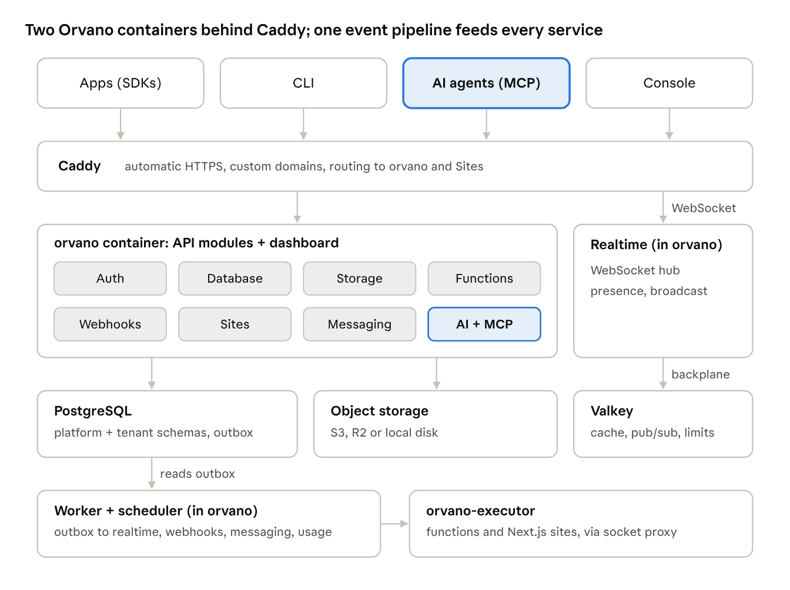
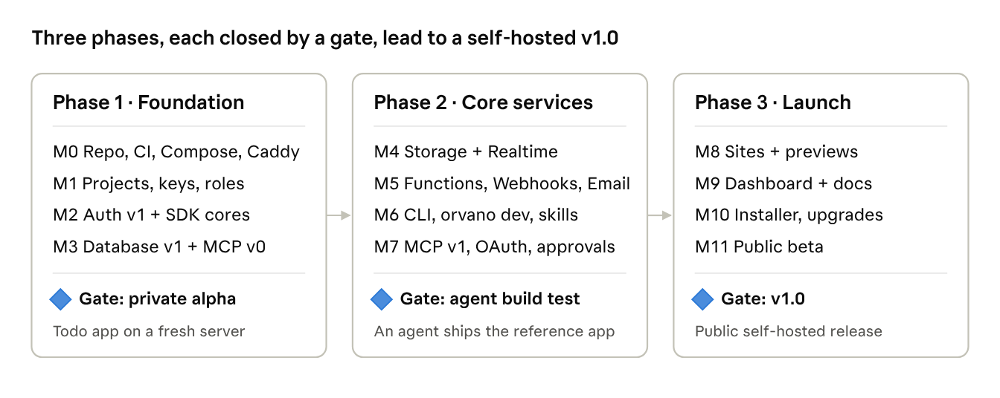

# Orvano — Platform Design Spec v0.1

Nov 27, 2026 · @Ateyib A

## Summary

Orvano is an open-core backend-as-a-service on .NET 10 (LTS, supported to November 2028). It ships auth, Postgres-backed databases, storage, realtime, functions, webhooks, sites and messaging, plus a console, a CLI and SDKs for Flutter, Dart, TypeScript and Next.js. What sets it apart: it is built for AI agents first. Every capability is exposed through one machine-readable contract that drives the REST API, the SDKs, the CLI, the MCP server and the docs, so an agent can build a whole app against Orvano without a human clicking through the console.

The reference point is Appwrite (an open-source BaaS with the same service list). Orvano should match its breadth over time but differ in three ways: a typed, Postgres-native data layer instead of a document abstraction; an agent workflow that ships with the platform (MCP server, skills, sandbox projects, plan-and-apply schema changes); and a .NET core that is easy for C# shops to self-host and extend. Appwrite now also ships an MCP server, so "has MCP" is table stakes. The edge has to be depth: safe agent permissions, dry runs, and project-aware skills.

### Design principles

1. **Contract first.** One OpenAPI 3.1 spec plus one event catalog is the source of truth. SDKs, CLI commands, MCP tools and docs are generated from it. Nothing is hand-written twice.
2. **Agents are first-class users.** Every operation has a dry-run mode, structured errors with a fix hint, and idempotency keys. Agents get scoped, expiring tokens, never root keys.
3. **Config as code.** A project is fully described by `orvano.json` plus migration files. The console, CLI and MCP all read and write the same model, so humans and agents never drift apart.
4. **Postgres at the core.** One database engine for platform metadata and tenant data. Row-level security enforces permissions. No custom query engine.
5. **Boring infrastructure, sharp product.** Use proven parts (Postgres, Redis/Valkey, S3-compatible storage, containers). Spend novelty on developer and agent experience.
6. **Self-hosted first.** `docker compose up` on one server gives a complete Orvano. v1 targets small-to-medium apps on a single node. A hosted cloud may come later from the same images, but v1 builds nothing for it.
7. **Distinct identity.** Own naming, information architecture and visual design. Learn from Appwrite and Supabase but copy neither their UI nor their API shapes.

## Product scope

v1 is self-hosted first and deliberately small: enough for small-to-medium apps, nothing more. Each service is trimmed in a step-by-step review; the Status column tracks which ones are settled.

| Service | v1 (self-hosted) | Later | Status |
| --- | --- | --- | --- |
| Auth | Email+password, magic link, email OTP, Google, Apple; sessions; user labels; account linking by verified email | Teams and roles, MFA, passkeys, phone OTP, more OAuth providers, SSO, anonymous users, hooks | Locked |
| Database | Tables, 9 column types, indexes, one-to-many relations, table rules + owner permissions, filter/sort/paginate, migrations, server-side transactions, nightly backups, read-only SQL console | Per-row permissions, aggregations, vector and full-text search, client transactions, replicas, branching | Locked |
| Storage | Buckets, resumable uploads, bucket rules + owner permissions, signed URLs, basic image transforms, local disk or S3 | CDN, antivirus, file versioning, customer-managed keys | Locked |
| Realtime | Row, file and account events with equality filters; presence; broadcast; resume after reconnect | Offline sync, full filter syntax, change streams to external sinks | Locked |
| Functions | Node/TS, Dart, .NET; deploy from CLI, upload or GitHub; HTTP, event, cron triggers; secrets; Docker sandbox | Python and more runtimes, GitLab, long-running jobs, workflows | Locked |
| Webhooks | Event patterns, Standard Webhooks signing, 24h retries, 7-day delivery log, replay, test send | Filter expressions, fan-out to queues | Locked |
| Sites | Static/SPA and Next.js SSR; CLI, upload or GitHub deploys; preview URLs per branch; custom domains with automatic HTTPS | Edge cache, more frameworks | Locked |
| Messaging | Email over SMTP: templates, topics, scheduling, delivery log | Push (FCM), SMS (Twilio), provider APIs, in-app inbox | Locked |
| AI layer | Built-in MCP server (\~20 tools), token + OAuth agent auth, approval queue, skills pack, llms.txt docs, dry runs | Console assistant, AI gateway, evals | Locked |

Out of scope for v1: managed cloud, billing, quotas per plan, Kubernetes, multi-region, built-in environments (use separate projects), GraphQL. The API keeps room for each without breaking changes.

## Architecture and tech stack

Status: **locked** for v1. Orvano self-hosts as two containers of its own behind a bundled Caddy, on one Docker Compose server. The `orvano` container is a modular monolith: API, realtime, worker, scheduler, MCP server and the dashboard in one .NET process, each as an isolated module. Only the executor runs apart, because it controls Docker. Modules can be split out later if load demands it.

**Request path:** client SDK, CLI or MCP client → Caddy (HTTPS, custom domains, routing) → `orvano` → Postgres, file storage or the job queue. Any state change writes an event to an outbox table in the same transaction. The worker module reads the outbox and fans each event out to realtime, webhooks, function triggers and email. One event pipeline, many consumers.



The AI agent path is not a side door: MCP calls land in the same API modules and permission checks as SDK calls.

### Deployables

| Container | Role | Notes |
| --- | --- | --- |
| `caddy` | Automatic HTTPS (Let's Encrypt), custom domains via on-demand TLS, wildcard cert for `*.sites.<domain>` via DNS-01, routing | Orvano exposes an `ask` endpoint so Caddy only issues certificates for domains registered in Orvano |
| `orvano` | API modules, realtime WebSockets, worker, scheduler, MCP at `/mcp`, dashboard (static export served at `/console`) | One .NET 10 process; scale out later with Valkey |
| `orvano-executor` | Builds and runs functions and Next.js sites in sandboxed containers; serves static site files | Talks to Docker through a restricted socket proxy (`docker-socket-proxy`), never the raw socket |
| `postgres` | PostgreSQL 17, platform + tenant schemas | Bundled; or `DATABASE_URL` to an external one |
| `valkey` (optional) | Pub/sub and shared cache | Only for multiple `orvano` instances |
| `minio` (optional) | S3-compatible storage | Default is local disk volume |

**Minimum server:** 2 vCPU, 4 GB RAM, Linux x64 or arm64, Docker Engine with Compose v2.

### Install, upgrade, backup

- **Install:** `curl -fsSL https://get.orvano.dev | sh` checks Docker, asks for domain, admin email and SMTP, writes `docker-compose.yml` and `.env` (with generated secrets) to `/opt/orvano`, and starts the stack. `orvano server init` does the same from the CLI.
- **First run:** the dashboard creates the instance admin and runs a setup check: DNS for the main and wildcard domains, HTTPS, test email, executor reachability.
- **Upgrade:** `orvano server upgrade` takes a backup, pulls new images, runs platform migrations on startup, and restarts. Rollback = restore that backup and pin the previous image tag. SemVer releases; breaking changes flagged in release notes; the dashboard shows when an update exists.
- **Backup:** nightly Postgres dump plus local-disk files, to a local folder or S3, retention 7 days by default. `orvano server backup` / `orvano server restore`.
- **Monitoring:** `/healthz` and `/readyz`, structured JSON logs to stdout, optional Prometheus `/metrics`; OpenTelemetry export off by default.
- **Supported target:** Docker Compose on one server. Running under Coolify or Dokploy is documented. Helm/Kubernetes comes later.

### Stack choices

| Layer | Choice | Why |
| --- | --- | --- |
| Runtime | .NET 10, C# 14, ASP.NET Core minimal APIs | LTS to Nov 2028; fast; Native AOT for CLI and small services |
| Local orchestration | Aspire 13 AppHost (contributors only; users get Docker Compose) | One command spins up Postgres, Valkey, storage and all processes for contributors |
| Primary database | PostgreSQL 17+ | Platform metadata and tenant data; RLS; pgvector and full-text later |
| Data access | EF Core 10 for platform metadata; Npgsql + generated SQL for tenant tables | Tenant schemas are dynamic, so a typed ORM does not fit there |
| Cache, pub/sub, rate limits | Valkey (Redis-compatible, BSD) | Realtime backplane, sessions cache, distributed locks |
| Job queue | Postgres-backed durable queue (Wolverine, or a `SKIP LOCKED` queue) | No extra broker for self-hosters; outbox in the same transaction |
| Object storage | S3 API; adapters for AWS S3, Cloudflare R2, local disk | Self-host on disk, cloud on R2/S3 |
| Function sandbox | Containers via containerd; gVisor isolation in cloud | Untrusted code needs a kernel boundary; Firecracker is a later option |
| Auth crypto | ASP.NET Core Identity password hasher, JWT (ES256), Data Protection keys in Postgres | Standard, audited primitives |
| MCP | `ModelContextProtocol.AspNetCore` (official C# SDK, v2.x) | Stable, tracks the 2026-07-28 MCP spec, stateless HTTP by default |
| Observability | Health endpoints, JSON logs, optional Prometheus metrics and OpenTelemetry export | Standard; Aspire dashboard in dev |
| Console | Next.js static export, React, Tailwind, shadcn/ui, TanStack Query; served by the orvano container | Dogfoods the Next.js and TS SDKs |
| Docs | Astro Starlight in `website/`, served at orvano.dev/docs; built-in search; API reference generated from the OpenAPI contract | Docs-first and fully static; the `starlight-llms-txt` plugin emits `llms.txt`, `llms-full.txt` and `llms-small.txt`; themed with the design system's `tokens.css` |
| Testing | xUnit v3, Testcontainers, Playwright for console, contract tests from OpenAPI | Real Postgres in tests |

## Core platform model

Everything hangs off a three-level tree: Organization → Project → resources. There are no built-in environments in v1: dev and production are separate projects (`myapp-dev`, `myapp-prod`), and `orvano dev` runs a local copy for offline work. `orvano.json` plus migrations make it easy to apply the same setup to both.

| Entity | Key fields | Notes |
| --- | --- | --- |
| Organization | id, name, slug, members (admin/developer/viewer) | Membership boundary; a self-hosted instance usually has one |
| Project | id (`prj_…`), org, name | Own Postgres schema, buckets, functions, secrets, auth settings |
| Platform (client app) | type (web, flutter-ios, flutter-android, …), origin or bundle id | Allowed origins for CORS and OAuth redirects |
| API key | `ork_…`, scopes, project, expiry | Server keys. Shown once, stored hashed |
| Agent token | `ora_…`, scopes, project, expiry (default 8h), dry-run-only flag, issuing human | Issued to MCP clients via OAuth; every action is audit-logged with the agent's name |
| Audit event | actor (user/key/agent), action, target, diff, ip, time | Immutable; shown in the console and queryable by agents |

### IDs and naming

Prefixed, sortable IDs (`usr_01JF…`, TypeID/UUIDv7 under the prefix). The prefix tells humans and agents what an ID is at a glance, and lets the API reject a wrong-type ID with a clear error.

### Permissions

One permission language across database, storage and functions, compiled to Postgres RLS where possible.

- Principals: `any`, `guests`, `users`, `user:<id>`, `label:<label>`. Teams come later.
- Actions: `read`, `create`, `update`, `delete`.
- Rules live at table/bucket level, plus an owner rule ("only the row's or file's owner"). Server API keys bypass rules; agent tokens never do unless the token has the `admin` scope.
- Policies can reference row columns (`owner_id = auth.uid()`), which compile straight into RLS `USING` clauses.

### Config as code

`orvano.json` at the app's repo root declares tables, buckets, functions, sites, webhooks, messaging topics and auth settings. Database changes live in `orvano/migrations/*.sql` (or generated from the JSON). `orvano plan` shows a diff; `orvano apply` executes it. The console writes to the same model and can export it, so a project created by clicking can be pulled into Git.

## Service designs

Each module owns one Postgres schema (`auth`, `db_meta`, `storage`, `functions`, …) in the platform database, plus one tenant schema per project. Modules talk to each other only through C# interfaces in `Orvano.Contracts` and through events, never through each other's tables.

### Auth

Status: **locked** for v1.

- **Methods:** email + password (with verification email and password reset), magic link, one-time passcode by email, Google sign-in, Apple sign-in. Google and Apple use OAuth/OIDC with PKCE; the Flutter SDK uses native Sign in with Apple and Google sign-in where available.
- **Sessions:** short-lived access JWT (15 min, ES256, per-project signing key with rotation and a JWKS endpoint) plus a rotating refresh token stored hashed. Sign out and sign out of all devices. Web uses httpOnly cookies through the Next.js SDK; mobile stores tokens in secure storage.
- **Account linking:** an OAuth sign-in whose verified email matches an existing account joins that account instead of creating a duplicate.
- **User labels:** simple tags (`admin`, `pro`) set by server keys or the console, usable in permissions as `label:<label>`.
- **Passwords:** Argon2id hashing, minimum length 8, breached-password check (k-anonymity) on by default.
- **Rate limits:** per IP and per email on sign-in, sign-up, magic link and passcode sends.
- **Email:** auth emails need SMTP; setup asks for SMTP settings and offers a "send test email" button. Templates (verification, magic link, passcode, reset) are editable in the console.
- **Console:** user list with search, user detail, block/unblock, delete, revoke sessions.
- **Orvano as an OAuth server:** the same module issues console sessions and agent tokens, so MCP clients sign in through standard OAuth.
- **Later:** teams and roles, MFA (TOTP), passkeys, phone OTP, more providers, SSO, anonymous users, sign-up hooks.

### Database

Status: **locked** for v1.

- **Model:** a table is a real Postgres table in the project's schema, with automatic `id` (UUIDv7), `created_at` and `updated_at`. Column types: text, integer, decimal, boolean, datetime, json, enum, file (storage reference), relation (one-to-many foreign key).
- **Indexes:** single, composite and unique.
- **API:** auto-generated REST per table: `GET /v1/db/{table}?filter=&sort=&select=&limit=&cursor=`, `GET /v1/db/{table}/{id}`, `POST`, `PATCH`, `DELETE`, plus bulk insert. Filters: `eq`, `neq`, `gt`, `gte`, `lt`, `lte`, `in`, `contains` (case-insensitive), `is_null`. Sorting, cursor pagination and an optional total count. The filter grammar is a small typed AST parsed in .NET and turned into parameterized SQL, never string concatenation.
- **Relations:** `select=*,author(name,avatar)` expands foreign keys one level deep. Many-to-many is modelled with a join table.
- **Permissions:** table-level rules per action (`any`, `guests`, `users`, `user:<id>`, `label:<label>`) plus an owner rule ("only the row's owner", via an `owner_id` column set automatically on create). Compiled to Postgres RLS. Each request runs in a transaction with `SET LOCAL role` and `SET LOCAL orvano.claims`.
- **Transactions:** server-side only (server API keys and functions) through `POST /v1/db/transactions`. Client SDKs do single writes and bulk inserts.
- **Schema changes:** only through migrations (console, CLI or MCP each create one). Each has `plan` (SQL preview, destructive-change warning) and `apply`. Dropping a column or table always needs an explicit confirmation; for agents it goes to the approval queue.
- **Typed clients:** `orvano types` generates Dart and TypeScript models.
- **Backups:** nightly `pg_dump` to local disk or S3 with configurable retention; `orvano db backup` and `orvano db restore` in the CLI.
- **Console:** spreadsheet-style table editor, schema editor, migration history with diffs, read-only SQL console (SELECT only, run in a read-only transaction with a statement timeout).
- **Later:** per-row permission lists, aggregations, many-to-many helpers, vector and full-text search, client-side transactions, read replicas, branching.

### Storage

Status: **locked** for v1.

- **Buckets:** name, max file size, allowed MIME types, public or private, permission rules.
- **Files:** upload, download, list, delete, replace. Metadata (owner, size, MIME, SHA-256, custom JSON) lives in Postgres; bytes on local disk (default) or any S3-compatible store (AWS S3, Cloudflare R2, MinIO).
- **Uploads:** single request for small files; chunked, resumable uploads (tus protocol) above \~10 MB. SDKs pick the mode automatically and resume after a dropped connection.
- **Permissions:** bucket-level rules plus the owner rule, same language as the database.
- **Access:** `/v1/storage/{bucket}/{fileId}`; signed, expiring URLs for private files; plain URLs for public buckets.
- **Image transforms:** `?w=&h=&fit=cover|contain&format=webp|jpeg|png&q=` using ImageSharp or NetVips; results cached on disk with a size cap; limits on maximum output dimensions to stop abuse.
- **Database link:** the `file` column type references a file; deleting a row can optionally delete its files.
- **Console:** file browser with previews, drag-and-drop upload, bucket settings.
- **Later:** CDN, antivirus scanning, file versioning, customer-managed encryption keys.

### Realtime

Status: **locked** for v1.

- **Connection:** one WebSocket per client at `wss://<host>/v1/realtime`, small JSON protocol (`subscribe`, `unsubscribe`, `event`, `presence`, `broadcast`, `ping`). Plain WebSocket, not SignalR, so the Dart and TS SDKs stay thin. Runs inside the API process; Valkey pub/sub only when running several API instances.
- **Channels:** `db.{table}`, `db.{table}.{rowId}`, `storage.{bucket}`, `account` (the signed-in user's own events), `presence.{room}`, `broadcast.{room}`.
- **Filters:** table subscriptions accept equality filters (`room_id=42`, combinable with AND).
- **Permissions:** every event is checked per subscriber with the same rule engine as the REST API before delivery. Broadcast and presence rooms use rules set per room prefix (default: signed-in users).
- **Presence:** join/leave/state per room, with a small custom state object (e.g. `{ "typing": true }`); cleaned up on disconnect.
- **Broadcast:** ephemeral messages to everyone in a room, never stored; size and rate limited.
- **Reliability:** events come from the outbox; the client resumes with a last-event id and receives missed events from a short buffer (e.g. the last 2 minutes) after reconnecting.
- **SDKs:** Dart `Stream`, TypeScript callback or async iterator; docs show `StreamBuilder` and a React hook.
- **Console:** live event inspector, active connection count.
- **Later:** offline sync, full filter syntax, change streams to external sinks, function execution events.

### Functions

Status: **locked** for v1.

- **Runtimes:** Node.js 22 (JavaScript/TypeScript), Dart 3, .NET 10 (C#). Each is a base image plus a tiny HTTP shim and starter template.
- **Deploy:** `orvano functions deploy`, a zip upload in the console, or GitHub. Every deployment is kept; switching the active one is an instant rollback.
- **GitHub deploy:** the console's setup wizard creates a GitHub App for this instance through GitHub's app-manifest flow (one click, no shared Orvano app). Link a repo, branch and folder to a function; a push triggers a build. GitHub must be able to reach the instance's public URL for webhooks; an instance behind a firewall uses CLI deploys from CI instead.
- **Builds:** the worker queues the build, the executor builds an image from the runtime base and stores it locally. Build logs stream to the console.
- **Triggers:** HTTP (`https://<host>/fn/<project>/<function>` or a custom domain), events from the catalog (`db.orders.created`, `auth.user.created`), cron schedules, and direct calls from SDKs.
- **Context:** request data, the calling user (if any), a short-lived server key scoped to the project, project secrets as env vars, structured logs.
- **Limits:** timeout 15s by default, configurable up to 5 min; memory and concurrency caps per function.
- **Sandbox:** each function runs in its own Docker container with CPU/memory limits, a read-only root filesystem and no access to Orvano's internal network. Warm containers are kept for active functions. gVisor (`runsc`) is an optional hardening setting.
- **Console:** function list, deployments, run history, logs, invoke panel, triggers, secrets.
- **Later:** Python and more runtimes, GitLab/Bitbucket, long-running jobs, GPUs, workflows.

### Webhooks

Status: **locked** for v1.

- Subscribe an HTTPS URL to event patterns (`db.posts.*`, `auth.user.created`, `storage.avatars.*`).
- Each delivery is signed in the Standard Webhooks format (`webhook-id`, `webhook-timestamp`, `webhook-signature`, HMAC-SHA256), and the id doubles as an idempotency key.
- Retries with exponential backoff for up to 24h. After repeated failures the webhook auto-disables and the instance admin gets an email.
- Delivery log keeps request, response and latency for 7 days, with replay and a "send test event" button in the console, CLI and MCP.
- **Later:** filter expressions, fan-out to queues, longer log retention.

### Sites

Status: **locked** for v1.

- **Site types:** static sites and SPAs (React, Vue, Flutter web, any build output) with an optional SPA fallback route; Next.js with SSR, run from its standalone output in a container on the same executor as functions.
- **Deploy:** CLI, zip upload, or GitHub (same instance GitHub App as functions). Builds run in the executor with logs streamed to the console.
- **Deployments:** every deploy is immutable and kept; production is a pointer you move, so promote and rollback are instant.
- **Previews:** every branch and pull request deploy gets its own URL (`<deploy>.<site>.sites.<your-domain>`), posted back to the PR as a GitHub comment. Needs a wildcard DNS record pointing at the server.
- **Domains:** custom domains with automatic HTTPS through Let's Encrypt (HTTP-01 for single domains, DNS-01 for the wildcard preview domain via common DNS providers, e.g. Cloudflare).
- **Config:** environment variables per site; production and preview can differ.
- **Later:** edge cache/CDN, image optimization, more SSR frameworks (Astro, SvelteKit, Nuxt).

### Messaging

Status: **locked** for v1: **email only, over SMTP.**

- **Provider:** any SMTP server (Resend, Amazon SES, Postmark, Mailgun, Gmail, self-run Postfix). One SMTP config per instance, overridable per project. The same config sends auth emails.
- **Recipients:** a user, a list of users, or a topic users subscribe to (`news`, `order-updates`). SDKs manage the signed-in user's topic subscriptions; unsubscribe links are added automatically to topic emails.
- **Templates:** HTML + text with `{{variables}}`, live preview and "send test". Auth emails (verification, magic link, passcode, reset) are built-in templates you can edit.
- **Sending:** server keys, functions and the console only; clients cannot send. Send now or schedule.
- **Delivery log:** queued, sent, failed with the SMTP error. (SMTP gives no delivery or open tracking.)
- **Later:** push via FCM/APNs, SMS via Twilio, provider APIs with bounce webhooks, in-app inbox.

## API conventions

REST + JSON over HTTPS, versioned in the path (`/v1`), described by a single OpenAPI 3.1 document generated from the C# endpoints (`Microsoft.AspNetCore.OpenApi`) and checked into Git. CI fails if the spec changes without a matching SDK regeneration.

- **Base URL:** `https://<instance>/v1` (e.g. `https://orvano.example.com/v1`). The project comes from the `Orvano-Project` header or from the API key, which is bound to one project.
- **Auth:** `Authorization: Bearer <jwt | api key | agent token>`.
- **Resource style:** plural nouns, `snake_case` JSON fields, ISO-8601 UTC timestamps, prefixed IDs.
- **Pagination:** cursor-based: `?limit=50&cursor=…`, and the response returns `next_cursor`.
- **Idempotency:** `Idempotency-Key` header on every POST; results are cached for 24h.
- **Dry run:** `Orvano-Dry-Run: true` on any mutating call returns the planned effect (SQL, files touched, events that would fire) without doing it. This matters most for agents.
- **Errors:** RFC 9457 problem+json, extended with `code` (stable, e.g. `db.column_not_found`), `hint` (what to do next, written for both humans and LLMs), `docs_url` and `request_id`.

```json
{
  "type": "https://orvano.dev/errors/db.column_not_found",
  "title": "Column not found",
  "status": 400,
  "code": "db.column_not_found",
  "detail": "Table 'posts' has no column 'autor_id'.",
  "hint": "Did you mean 'author_id'? List columns with GET /v1/db/tables/posts.",
  "docs_url": "https://orvano.dev/docs/database/columns",
  "request_id": "req_01JF…"
}
```

- **Rate limits:** `RateLimit-*` headers (IETF draft) and 429 with `Retry-After`.
- **Events:** one catalog (`events.yaml`) names every event (`db.row.created`, `storage.file.deleted`, …) and its payload schema. Realtime, webhooks, function triggers and docs all use it.
- **Admin vs client surface:** endpoints are tagged `client` (callable with a user JWT) or `server` (needs an API key). SDK generators split on this tag, so a Flutter app never ships admin methods.

## AI-native layer

The goal: a developer types "build me a Flutter recipe app with login, photo uploads and live comments on Orvano" into Claude Code, Cursor or Codex, connected to their self-hosted Orvano, and the agent does the rest. It creates the project, the tables, the permissions, the buckets and the code, all safely. Four pieces make that work.

### 1. MCP server

Status: **locked** for v1.

- **Built into every instance:** `https://<your-server>/mcp` (Streamable HTTP, stateless), mounted inside the API so it reuses the same services and permission checks. Built with the official C# SDK (`ModelContextProtocol.AspNetCore` v2.x). A shared `mcp.orvano.dev` comes with a cloud, later.
- **Local:** `orvano mcp` (stdio) using the CLI's stored credentials.
- **Auth, two ways:** (1) a scoped agent token that `orvano init --agent` creates and writes into the editor's MCP config; (2) OAuth 2.1 sign-in (the Auth module acts as authorization server with dynamic client registration) for remote clients such as Claude, ChatGPT and Cursor. Both produce an agent token bound to one project with an expiry.
- **Curated tools, not 1:1 endpoints:** about 20 task-level tools matching the v1 scope, generated from OpenAPI operations tagged `x-mcp`, with LLM-oriented descriptions kept in the contract.

| Group | Tools |
| --- | --- |
| Discover | `get_project_overview`, `search_docs`, `get_skill` |
| Database | `describe_schema`, `plan_migration`, `apply_migration`, `query_rows`, `insert_rows`, `set_table_permissions`, `generate_types` |
| Auth | `configure_auth`, `create_test_user`, `list_users` |
| Storage | `create_bucket`, `list_files` |
| Functions | `deploy_function`, `invoke_function`, `get_function_logs` |
| Sites | `deploy_site`, `get_deployment_status` |
| Webhooks and email | `create_webhook`, `replay_delivery`, `send_test_email` |
| Ops | `get_logs`, `explain_error` (takes a request id, returns cause and fix), `list_pending_approvals` |

- **Resources:** `orvano://project/config` (the current `orvano.json`), `orvano://schema`, `orvano://docs/{slug}`, `orvano://events`.
- **Prompts:** `scaffold_app`, `add_auth`, `design_schema`, `debug_request`.
- **Safety model:** agent tokens are scoped to one project and expire (default 8h). Every mutating tool supports dry run. Destructive changes (drop column or table, delete bucket, delete function or site, rotate keys) go to an **approval queue**: the agent gets a `pending_approval` result with a plan id, the human approves or rejects in the dashboard (or the MCP client's confirm prompt where supported), and the agent can poll `list_pending_approvals`. Every agent action is tagged in the audit log.

### 2. Orvano skills

A public repo `OrvanoHQ/skills` holds Agent Skills: folders with a `SKILL.md` plus reference files and example code. `orvano skills install` copies them into the right place for each agent (`.claude/skills/`, `.cursor/rules/`, `AGENTS.md` sections, `.github/copilot-instructions.md`). The MCP tool `get_skill` serves the same content on demand.

Starter set: `orvano-quickstart`, `orvano-auth-flutter`, `orvano-auth-nextjs`, `orvano-schema-design`, `orvano-permissions`, `orvano-storage-uploads`, `orvano-realtime`, `orvano-functions`, `orvano-deploy-site`, `orvano-email`, `orvano-debugging`. Migration skills (from Firebase, Supabase) come later.

Each skill states when to use it, the exact SDK calls with current signatures, common mistakes, and a checklist the agent runs before it finishes (types regenerated, permissions set, no server key in client code). Skills are versioned with the SDKs and tested in CI: an eval harness runs a coding agent against each skill and checks that the app builds.

### 3. Docs built for machines

- `orvano.dev/llms.txt` (an index), `llms-full.txt` (everything) and `llms-small.txt` (condensed), generated by the `starlight-llms-txt` plugin on each docs deploy.
- Every docs page is also served as Markdown (`/docs/auth/oauth.md`).
- Code samples are compiled and type-checked in CI so agents never copy stale APIs.
- An `AGENTS.md` template is dropped into new projects by `orvano init`.

### 4. Agent-friendly platform behaviour

The API conventions above (dry runs, idempotency, error hints, typed IDs) exist mainly for agents. On top of them: `orvano init --agent` writes `orvano.json`, the skills and the MCP config for the detected editor in one step; a separate `-dev` project or `orvano dev` gives agents a safe place to experiment; `orvano context` prints a compact project summary (schema, buckets, functions, auth methods) for pasting into any chat. The in-console Orvano Assistant is deferred until after v1.

## SDKs and code generation

Five packages at launch. Each is a hand-written core (HTTP, auth session, retries, realtime socket) plus service classes generated from the OpenAPI spec by Orvano's own generator.

Status: **locked** for v1. Every SDK covers only v1 features: auth (five methods, sessions, labels), database, storage (resumable uploads, image URLs), realtime (presence, broadcast), function calls, email topic subscriptions.

| Package | Registry | For | Contents |
| --- | --- | --- | --- |
| `orvano` | pub.dev | Pure Dart: Dart servers, Dart functions | Client and server (API key) modes, all v1 services, realtime |
| `orvano_flutter` | pub.dev | Flutter apps | Wraps `orvano`; native Google and Apple sign-in, secure token storage, deep-link handling for magic links, `AuthStateBuilder`, realtime `Stream`s |
| `orvano` | npm | Browser, React Native, Node, Bun, Deno | One package, one version. Root import = isomorphic client; `orvano/server` = server-key admin surface (throws in browsers); `orvano/next` = Next.js helpers. ESM, tree-shakable, no deps beyond `fetch`/`WebSocket` |
| `Orvano.Sdk` | NuGet | Server-side C# (.NET functions, .NET backends) | Server-key surface for all v1 services |

`orvano/next` gives `createServerClient()` for Server Components, Server Actions and Route Handlers, cookie sessions, a middleware that refreshes tokens, and `<OrvanoProvider>` for client components.

### Generator

- `tools/Orvano.SdkGen` (a .NET console app) reads `openapi.json` and `events.yaml` and renders Scriban templates per language. Generic OpenAPI generators produce code that feels foreign, and agents copy whatever idiom they see, so the output must read like hand-written code.
- Each operation carries `x-orvano-sdk` hints: method name, grouping, `client`/`server` surface, pagination style.
- The same generator emits the CLI command tree and MCP tool definitions, so all surfaces stay in sync.
- CI: regenerate → compile → run SDK integration tests against a Testcontainers Orvano → publish with npm provenance and pub.dev verified publisher.

### Shape of the API

```dart
final orvano = Orvano(project: 'prj_123', env: 'production');
await orvano.auth.signInWithPassword(email: e, password: p);
final posts = await orvano.db.from('posts')
    .select('*, author(name)')
    .eq('published', true)
    .order('created_at', desc: true)
    .limit(20)
    .get();
final sub = orvano.realtime.channel('db.posts').listen((e) => ...);
```

```ts
// app/page.tsx (Server Component)
import { createServerClient } from 'orvano/next';
export default async function Page() {
  const orvano = await createServerClient();
  const { data: posts } = await orvano.db.from('posts').select('*').limit(20);
  return <PostList posts={posts} />;
}
```

Typed tables: `orvano types --lang dart|ts` generates row types, so `from<Post>('posts')` is fully typed. Versioning is SemVer per package, with one compatibility table mapping SDK versions to API versions.

## CLI

Status: **locked** for v1. `orvano` is a single native binary built with .NET 10 Native AOT and System.CommandLine, so it starts fast and needs no runtime, and it shares models and validation with the server. It ships through npm as `@orvano/cli` (bin name `orvano`, platform binaries as optional dependencies, the esbuild pattern; `npx @orvano/cli` for one-off use), Homebrew, winget, Scoop and the `get.orvano.dev` script. The npm name `orvano` belongs to the TypeScript SDK.

| Command | Purpose |
| --- | --- |
| `orvano login` / `logout` / `whoami` | Browser device-code login against a given instance URL; `--token` for CI |
| `orvano init [--template flutter\|next\|dart] [--agent]` | Link a folder to a project, write `orvano.json`, install skills and MCP config |
| `orvano link` | Point the folder at another project (e.g. `myapp-prod`) |
| `orvano dev` | Run a full local Orvano in Docker with dev defaults: no HTTPS, a fake SMTP inbox at `/mail`, seeded admin |
| `orvano plan` / `orvano apply` | Diff `orvano.json` and migrations against the linked project, then apply |
| `orvano db migrate new\|up\|status`, `orvano db pull` | Migration workflow; pull a dashboard-made schema into files |
| `orvano types --lang dart\|ts\|cs --out <dir>` | Generate typed models |
| `orvano functions create\|deploy\|invoke\|logs` | Function lifecycle |
| `orvano sites deploy\|list\|promote\|rollback` | Hosting |
| `orvano storage ls\|cp\|rm` | Files |
| `orvano secrets set\|list\|unset` | Project secrets |
| `orvano webhooks list\|replay` | Webhooks |
| `orvano logs [--follow] [--service]` | Tail logs |
| `orvano mcp` | Start the local stdio MCP server |
| `orvano skills install\|update` | Manage AI skills in the repo |
| `orvano context` | Print a compact project summary for AI chats |
| `orvano server init\|upgrade\|backup\|restore\|status` | Instance admin on the self-hosted server |

Rules for every command: `--json` output for scripts and agents; `--dry-run` on every mutation; non-interactive when `CI=true` or stdin is not a TTY; exit codes documented; errors print the API's `hint`. Commands that call the API are generated from the contract; workflow commands (`init`, `dev`, `plan`, `apply`, `deploy`) are hand-written.

## Dashboard (Orvano Console)

Status: **locked** for v1. The dashboard is a static Next.js export served by the `orvano` container at `orvano.example.com/console`, with v1 pages only. It has no private powers: it uses only the public API through the `orvano` TypeScript SDK, so anything a human can click, an agent or the CLI can also do. Layout: a slim left rail of services, a top bar with instance → project switcher and an approvals badge, and a command palette (`⌘K`) that can open any page or run any action. Light and dark themes follow the OS with a toggle.

**Roles:** Admin (everything, including instance settings and members), Developer (build, deploy and manage project data; no instance settings or member management), Viewer (read-only).

### Instance level

- Projects list with health and usage
- Instance settings: SMTP, domains and DNS check, GitHub App setup, backups and restore, updates
- Members and roles, instance audit log

### Project level

| Area | Pages |
| --- | --- |
| Overview | Requests, errors, users, storage, function runs; quick-start snippets for Flutter, Next.js and TypeScript; "Connect your AI" card with MCP config per editor |
| Auth | Users (search, block, delete, revoke sessions, labels), sign-in methods with Google/Apple setup, email templates, security settings |
| Database | Spreadsheet-style table editor, schema editor, migrations history with diff, permissions, read-only SQL console, backups and restore |
| Storage | Buckets, file browser with previews, upload, bucket settings |
| Realtime | Live event inspector, active connection count |
| Functions | List, deployments, run history, logs, invoke panel, triggers, secrets, GitHub link |
| Sites | Deployments, preview links, build logs, domains, env vars, promote and rollback |
| Webhooks | Endpoints, event selection, delivery log with request/response, replay, secret rotation |
| Email | Templates with preview, topics, compose and schedule, delivery log |
| AI | Connected agents and tokens, approval queue (pending plans with diff, approve or reject), MCP setup guide, agent activity timeline |
| Logs | Unified search across API, functions and sites; filter by request id |
| Settings | Platforms (web, iOS, Android), API keys, project members, export `orvano.json`, delete project |

### Orvano Assistant

Deferred until after v1. Planned as a chat panel grounded in the project's schema, logs and docs, calling the same MCP tools as external agents (same powers and approvals), using a model API key the self-hoster provides.

### Visual identity

Status: **locked** — Slate + Cobalt. Cool slate neutrals, one cobalt accent (`#2F5BFF` light / `#5B7FFF` dark), IBM Plex Sans for UI and IBM Plex Mono for IDs and code, borders not shadows, dense 36px tables on a 4px grid. The full tokens and brand book are in the [Orvano Design System](https://claude.ai/artifact/R46onEfP7urFbRc7V2XLLK); four reference screens (projects, approval queue, table editor, setup check) are in [Orvano Dashboard — Key Screens](https://claude.ai/artifact/8EuamiyPTRr6PzFhysmWcA). The coding agent copies `tokens.json` into `console/` and maps it onto shadcn/ui's CSS variables as the design system README describes.

## Security, tenancy, observability, deployment

### Security

- Secrets (API keys, refresh tokens, agent tokens) are stored as SHA-256 hashes; provider credentials and function secrets are encrypted with envelope encryption (a per-project data key wrapped by a KMS or a local master key).
- Tenant SQL is always parameterized and runs under a per-project Postgres role with RLS on; the platform role is never used for tenant queries.
- Function and site build sandboxes have no access to the platform network, an egress allowlist, CPU/memory limits and read-only root filesystems.
- Session cookies are host-only, hosted sites live on a separate wildcard subdomain, and uploaded files are served as downloads with a strict CSP, so neither a site nor an uploaded HTML file can read dashboard cookies (see Repositories and domains).
- Supply chain: signed container images (cosign), SBOMs, Dependabot/Renovate, npm provenance.
- Security headers, CSRF protection for cookie sessions, CORS from registered platforms only.
- A threat model doc and an external pen test before the cloud GA.

### Multi-tenancy and limits

- Every request resolves `org → project → env` in middleware and carries it in a scoped `TenantContext`; every platform table has `project_id` with RLS as a second wall.
- Quotas per plan (requests/min, storage GB, function GB-seconds, bandwidth, realtime connections, MAU) are enforced in the gateway (rate limits) and the worker (usage roll-ups every minute).
- Noisy neighbour controls: per-tenant connection limits, statement timeouts, function concurrency caps.

### Observability

- OpenTelemetry traces, metrics and logs from every process, with tenant and request id as attributes.
- Tenant-facing logs (what users see in the console) are a separate, filtered stream so platform internals never leak.
- SLOs: API p95 < 150 ms for simple reads, 99.9% monthly availability for cloud paid plans.

### Deployment targets

| Target | How | Who |
| --- | --- | --- |
| Local dev (contributors) | `dotnet run` the Aspire AppHost | Orvano developers |
| Local dev (users) | `orvano dev` (Docker Compose under the hood) | App developers, agents |
| Self-host (v1, supported) | Install script + Docker Compose on one Linux server; images on GHCR | Everyone |
| Kubernetes / Helm | Later | Larger teams |
| Hosted cloud | Later, same images | You |

**Licence (decided):** the Orvano server is Apache-2.0. SDKs, CLI, skills and templates are MIT. Add a `LICENSE`, a `NOTICE` and a contributor DCO sign-off check from the first public commit.

## Repositories and domains

Use one monorepo for everything that shares the contract, so a single PR can change an endpoint, regenerate SDKs and update docs together. That is also the easiest shape for a coding agent to work in. Keep skills and templates in their own public repos, because users pull from them directly.

| Repo (github.com/OrvanoHQ) | Contents | Licence |
| --- | --- | --- |
| `orvano` | Server, executor, dashboard, CLI, contract, SDK generator, SDKs, docs site, Compose files, install script | Apache-2.0 (server); MIT (SDKs, CLI), with a `LICENSE` file per folder |
| `skills` | Agent Skills pack, evals | MIT |
| `templates` | Starter apps: Flutter, Next.js, Dart server, functions | MIT |
| `homebrew-tap` | Homebrew formula for the CLI (`brew install orvanohq/tap/orvano`); created in M6, updated by the release workflow | MIT |
| `scoop-bucket` | Scoop manifest for the CLI on Windows; created in M6, updated by the release workflow | MIT |
| `.github` | Org profile, issue/PR templates, shared workflows | — |

**No SDK or CLI mirror repos in v1.** All SDKs (npm, pub.dev, NuGet) and the CLI publish straight from the monorepo, and issues live in one tracker. Read-only per-SDK mirrors can be added later if SDK users ask for them. winget needs no repo of ours: its manifest is a pull request to `microsoft/winget-pkgs`.

### Monorepo layout

```
orvano/
  AGENTS.md                 # written by /audit (from docs/design/agent-rules.md)
  docs/design/              # this spec, diagrams, agent-rules.md, design-system/, mockups/
  docs/scope/  docs/specs/  # written by /scope and /architect
  contract/                 # openapi.json (generated + committed), events.yaml, errors.yaml
  server/
    Orvano.sln
    src/
      Orvano.AppHost/       # Aspire orchestration for contributors
      Orvano.ServiceDefaults/
      Orvano.Host/          # the `orvano` container: wires modules, realtime, worker, MCP, serves dashboard
      Orvano.Executor/      # the `orvano-executor` container
      Orvano.Contracts/     # shared interfaces, events, IDs, errors
      Modules/
        Orvano.Modules.Projects/    # instance, projects, keys, roles, audit
        Orvano.Modules.Auth/
        Orvano.Modules.Database/
        Orvano.Modules.Storage/
        Orvano.Modules.Realtime/
        Orvano.Modules.Functions/
        Orvano.Modules.Webhooks/
        Orvano.Modules.Sites/
        Orvano.Modules.Email/
        Orvano.Modules.Ai/          # MCP tools, agent tokens, approvals
    tests/                  # unit, integration (Testcontainers), contract
  runtimes/                 # function base images: node, dart, dotnet
  console/                  # dashboard (Next.js static export)
  cli/                      # .NET Native AOT CLI + @orvano/cli npm wrapper
  sdks/
    dart/orvano/  dart/orvano_flutter/
    ts/orvano/              # one package: root, /server, /next
    dotnet/Orvano.Sdk/
  tools/Orvano.SdkGen/      # generator: SDKs, CLI commands, MCP tool defs
  website/                  # docs site (Astro Starlight), llms.txt build; kept out of docs/ so the skills' docs/scope and docs/specs stay internal
  deploy/                   # docker-compose.yml, Caddyfile, Dockerfiles, install.sh
  .github/workflows/
```

### Domains

**Your own domains (orvano.dev):**

| Host | Use |
| --- | --- |
| `orvano.dev` | Marketing site |
| `orvano.dev/docs`, `/llms.txt` | Documentation |
| `get.orvano.dev` | Install script |
| `ghcr.io/orvanohq/*` | Container images |

**A self-hosted instance (the user's domain, e.g. example.com):**

| Host | Use |
| --- | --- |
| `orvano.example.com` | Dashboard (`/console`), API (`/v1`), MCP (`/mcp`), functions (`/fn/...`) |
| `*.sites.example.com` | Hosted sites and preview deploys (wildcard DNS) |
| Any custom domain | Sites and functions, HTTPS issued on demand |

Isolation on a self-hosted instance: dashboard and API session cookies are host-only (no `Domain=` attribute) on `orvano.example.com`, so sites on `*.sites.example.com` cannot read or set them. Uploaded files are served with `Content-Disposition` and a strict CSP so they cannot run as pages. Claim the package names now: `orvano` and `orvano_flutter` on pub.dev, the `@orvano` scope and `orvano` package on npm, the `Orvano.*` prefix on NuGet, `orvano` on Homebrew.

## Roadmap

Status: **locked** for v1, milestone-based with no dates yet (add them once the pace of M0–M1 is known). Three phases, each ending in a gate you can demo. The AI layer comes early: MCP v0 lands with the database in M3, so you can build Orvano apps with agents from phase 1.



| Milestone | Delivers |
| --- | --- |
| M0 | Monorepo, CI, Docker Compose stack with Caddy, Aspire AppHost for contributors |
| M1 | Instance and projects, API keys, roles, audit log, dashboard shell |
| M2 | Auth v1; Dart, Flutter and TypeScript SDK cores |
| M3 | Database v1, `orvano types`, MCP v0 |
| M4 | Storage and Realtime |
| M5 | Functions (Node, Dart, .NET; GitHub deploys), Webhooks, Email |
| M6 | Full CLI, `orvano dev`, skills pack, C# SDK, Homebrew tap and Scoop bucket |
| M7 | MCP v1: OAuth sign-in, approval queue, full v1 tool set |
| M8 | Sites: static and Next.js SSR, preview links, custom domains |
| M9 | Dashboard complete, docs site (Astro Starlight), `llms.txt` |
| M10 | Install script, upgrades, backups, security review |
| M11 | Public beta with early users, then v1.0 |

SDKs, CLI commands, MCP tools and docs grow with every milestone; a milestone is done only when its slice works through all of them. The agent build test is the key gate: a coding agent, given only the skills and the MCP server, builds and deploys a reference app (auth, a table with permissions, uploads, live updates) with no human edits.

## Coding-agent handoff

The build uses the JS Mastery agent skills (`npx skills@latest add JavaScript-Mastery-Pro/skills -a claude-code`). This spec is source material: `/scope` turns it into `docs/scope/`, `/architect` turns decisions into specs in `docs/specs/`, and `/audit` writes `AGENTS.md`. Don't hand the agent this whole spec and say "build it".

### Where the design files live

| Path | What |
| --- | --- |
| `docs/design/spec.md` | This spec |
| `docs/design/architecture.png`, `roadmap.png` | Diagrams referenced by this spec |
| `docs/design/agent-rules.md` | Rules for coding agents; `/audit` folds them into `AGENTS.md` |
| `docs/design/design-system/` | `tokens.json`, `tokens.css`, brand book `README.md`, `cover.html` |
| `docs/design/mockups/` | Four reference screens as HTML + PNG |

### Workflow (greenfield)

1. `/scope`: plan from this spec. Delivery style: tracer bullet. Default tier: Alpha; Auth, permissions/RLS, the approval queue and function sandboxing as Beta. Milestones M0–M11 are the slice order; the three gates are phase boundaries.
2. `/architect stack`: record the stack decided here (no comparison); recommend the job queue.
3. Scaffold the monorepo layout with each stack's own tools.
4. `/audit`: write nested `AGENTS.md` files, folding in `docs/design/agent-rules.md` and pointing the console at `docs/design/design-system/` and `docs/design/mockups/`.
5. Per feature, in scope order: `/architect <feature>` → `/develop <feature>` → `/check verify` (+ `/test` for Beta features) → `/sync`. Run `/clear` between steps.

### Open decisions (settle before or during M0)

- [x] Licence: Apache-2.0 server; MIT SDKs, CLI, skills
- [x] Dev vs production: separate projects, no built-in environments
- [x] Hosting: self-hosted first, Docker Compose + Caddy; cloud later
- [x] TLS and domains: bundled Caddy; one user domain plus `*.sites` wildcard
- [x] Function sandbox: Docker containers via socket proxy; gVisor optional
- [x] Repos: one monorepo; no SDK/CLI mirror repos in v1; `homebrew-tap` and `scoop-bucket` repos added in M6
- [ ] Job queue: Wolverine vs a hand-rolled Postgres `SKIP LOCKED` queue (decide in `/architect stack`)
- [x] Visual identity: Slate + Cobalt design system and key-screen mockups (docs/design/design-system/, docs/design/mockups/)
- [ ] Import tools from Firebase/Supabase: after v1
